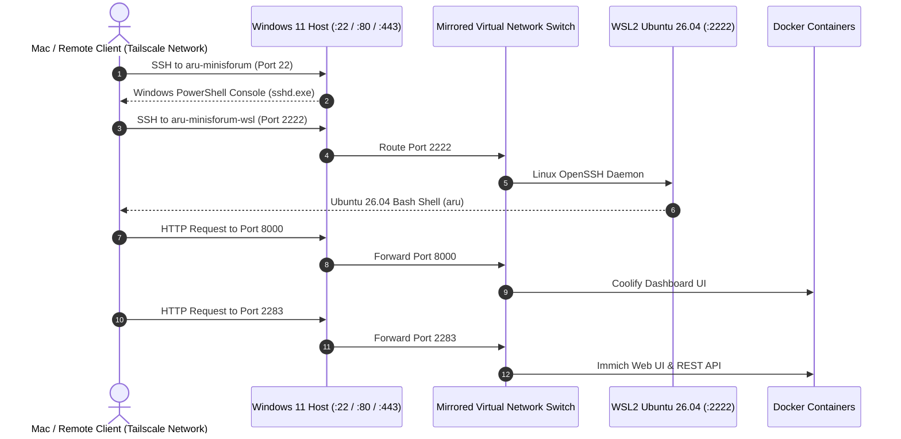
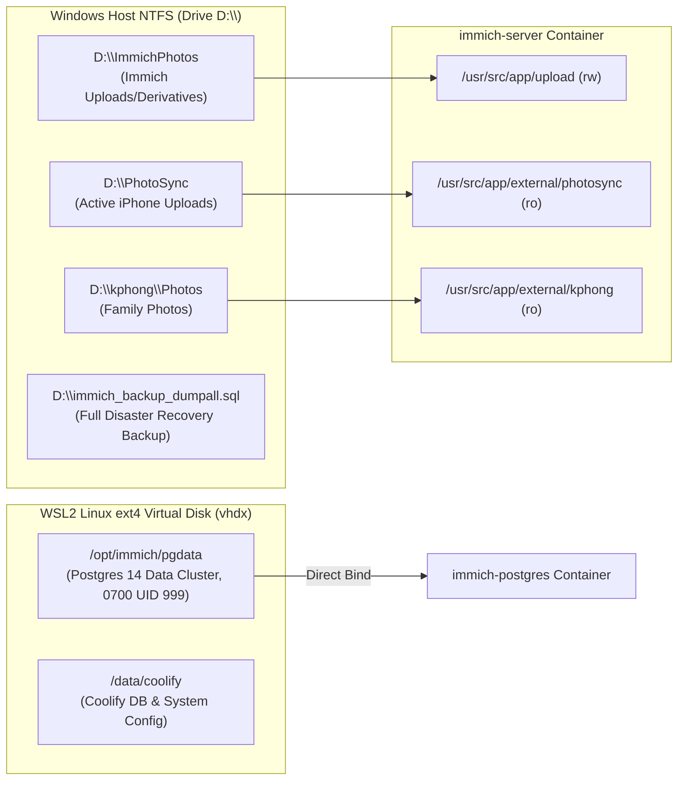
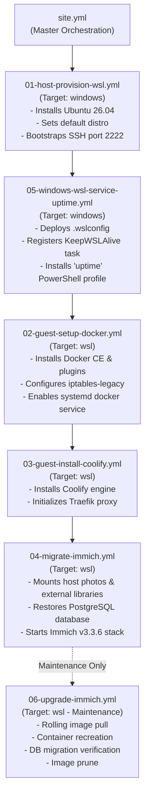

# WSL Docker Server Architecture

This document describes the design, system topology, networking model, and storage architecture for the `wsl-docker-server` infrastructure.

---

## 1. System Topology Overview

The infrastructure employs a **two-tier virtualization architecture** that runs containerized microservices (Coolify, Immich) inside a persistent **WSL2 Ubuntu 26.04 LTS (Resolute Raccoon)** environment hosted on a **Windows 11 (Minisforum)** physical server.

```mermaid
flowchart TD
    subgraph ControlNode ["Mac Control Node / Developer Workstation"]
        Ansible["Ansible CLI (Core 2.21+)"]
        SSHClient["OpenSSH Client (~/.ssh/config)"]
    end

    subgraph Host ["Windows 11 Pro Host (aru-minisforum)"]
        WinSSH["Microsoft OpenSSH (Port 22, sshd.exe)"]
        TaskSched["Windows Task Scheduler\n(KeepWSLAlive - S4U Token)"]
        WSLConfig["C:\\Users\\aru\\.wslconfig\n(networkingMode=mirrored, idleTimeout=-1)"]
        PSProfile["PowerShell Profiles\n(Custom 'uptime' Telemetry)"]
        
        subgraph StorageHost ["NTFS High-Capacity Host Storage (D:\\)"]
            UploadDir["D:\\ImmichPhotos (Upload/Library Volume)"]
            PhotoSyncDir["D:\\PhotoSync (Andy's iPhone Active Sync)"]
            KPhongDir["D:\\kphong\\Photos (User Kim Phong)"]
            SQLBackups["D:\\immich_backup_dumpall.sql (43 MB SQL Dump)"]
            RawPGData["D:\\immich_pgdata_raw (Raw Postgres 14 Cluster)"]
        end
    end

    subgraph VM ["WSL2 Lightweight Hyper-V VM (Ubuntu 26.04.1 LTS)"]
        WSLSSH["OpenSSH Server (Port 2222, sshd)"]
        Systemd["systemd (init, /etc/wsl.conf)"]
        IPTables["iptables-legacy (Docker Bridge Networking)"]
        DockerEngine["Docker CE 28+ Engine & Compose Plugin"]
        
        subgraph Workloads ["Docker Container Stacks"]
            subgraph CoolifyStack ["Coolify Engine & Proxy"]
                CoolifyApp["coolify:4.6.0 (Dashboard: :8000)"]
                CoolifyDB["coolify-db (PostgreSQL 15)"]
                CoolifyRedis["coolify-redis (Redis 7)"]
                TraefikProxy["coolify-proxy (Traefik: :80 / :443)"]
            end

            subgraph ImmichStack ["Immich Photolab Suite (v3.3.6)"]
                ImmichServer["immich-server:release (:2283)"]
                ImmichML["immich-machine-learning:release (:3003)"]
                ImmichPostgres["immich-postgres (PG 14 + Vector Extensions)"]
                ImmichRedis["immich-redis (Redis 6.2)"]
            end
        end
        
        subgraph Ext4Storage ["Fast Linux ext4 NVMe Storage"]
            OptImmich["/opt/immich/pgdata (ACID POSIX 0700 Permissions)"]
            OptDataCoolify["/data/coolify (Coolify State & DB)"]
        end
    end

    Ansible -->|"SSH (Port 22, PowerShell)"| WinSSH
    Ansible -->|"SSH (Port 2222, Linux apt/docker)"| WSLSSH
    SSHClient -->|"ssh aru-minisforum"| WinSSH
    SSHClient -->|"ssh aru-minisforum-wsl"| WSLSSH

    TaskSched -->|"wsl.exe -d Ubuntu-26.04 -u root sleep infinity"| Systemd
    DockerEngine --> Workloads

    ImmichServer -->|"/usr/src/app/upload"| UploadDir
    ImmichServer -->|"/usr/src/app/external/photosync (ro)"| PhotoSyncDir
    ImmichServer -->|"/usr/src/app/external/kphong (ro)"| KPhongDir
    ImmichPostgres -->|"/var/lib/postgresql/data"| OptImmich
```

---

## 2. Networking Architecture (Mirrored Mode)

WSL2 is configured with `networkingMode=mirrored` in [`wsl-config/.wslconfig`](file:///Users/aru/wsl-docker-server/wsl-config/.wslconfig). This shares the network namespace between the Windows host and Linux VM:

### Port Allocation Map

| Port | Service | Listening Host / Container | Protocol / Description |
| :--- | :--- | :--- | :--- |
| **`22`** | Windows OpenSSH Server | Windows Host (`sshd.exe`) | Administrative host PowerShell access |
| **`2222`** | Ubuntu OpenSSH Server | WSL2 Guest (`Ubuntu-26.04`) | Direct Linux administrative access & Ansible target |
| **`80`** | Traefik Reverse Proxy | Container (`coolify-proxy`) | HTTP ingress routing |
| **`443`** | Traefik Reverse Proxy | Container (`coolify-proxy`) | HTTPS SSL ingress routing |
| **`2283`** | Immich Photolab Server | Container (`immich-server:release`) | Immich Web UI & mobile API endpoint (v3.3.6) |
| **`3003`** | Immich Machine Learning | Container (`immich-machine-learning`) | Internal facial recognition & CLIP smart search |
| **`5432`** | PostgreSQL Database | Container (`immich-postgres` / `coolify-db`) | Internal relational database |
| **`6379`** | Redis In-Memory Cache | Container (`immich-redis` / `coolify-redis`) | Internal job queues & caching |
| **`8000`** | Coolify Dashboard | Container (`coollabsio/coolify:4.6.0`) | Coolify management UI |

---

## 3. Storage & Volume Strategy

### Why Dual Storage?
1. **Linux ext4 (`/opt/immich/pgdata`)**: PostgreSQL requires strict POSIX permissions (`0700` owned by UID `999`). NTFS filesystems in Windows lack native Linux permissions, causing PostgreSQL to fail if bound directly to NTFS. Storing `pgdata` on ext4 provides maximum database I/O performance and stability.
2. **Windows NTFS (`D:\`)**: High-capacity disk (7+ TB) housing the raw photo library (`D:\PhotoSync`, `D:\kphong\Photos`, `D:\ImmichPhotos`) and automated SQL dump backups (`D:\immich_backup_dumpall.sql`).

---

## 4. Ansible Infrastructure as Code Pipeline

The entire system lifecycle is automated through modular Ansible playbooks orchestrated by [`ansible/site.yml`](file:///Users/aru/wsl-docker-server/ansible/site.yml):

---

## 5. External Photo Library Configuration in Immich

Because photos are synchronized to the host via sync tools (e.g., PhotoSync), Immich mounts them as read-only **External Libraries**:

1. Log into Immich at **`http://100.75.152.123:2283`**.
2. Navigate to **Administration** → **External Libraries** → **Create Library**.
3. Set the import path to:
   - For Andy's iPhone: `/usr/src/app/external/photosync/Andy’s iPhone 17 Pro Max/Recents`
   - For Kim Phong: `/usr/src/app/external/kphong`
4. Click **Scan All Libraries**. Immich will index and generate thumbnails for all photos and videos without altering your original files.
