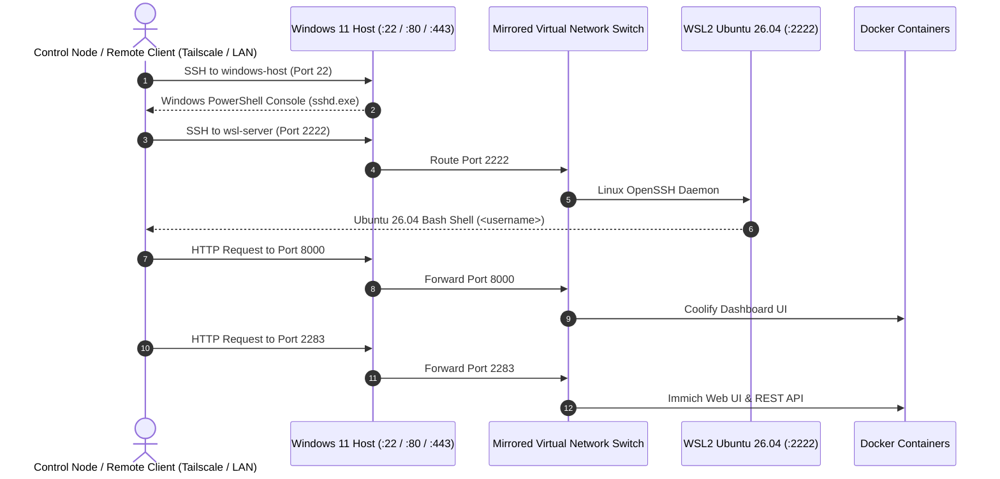
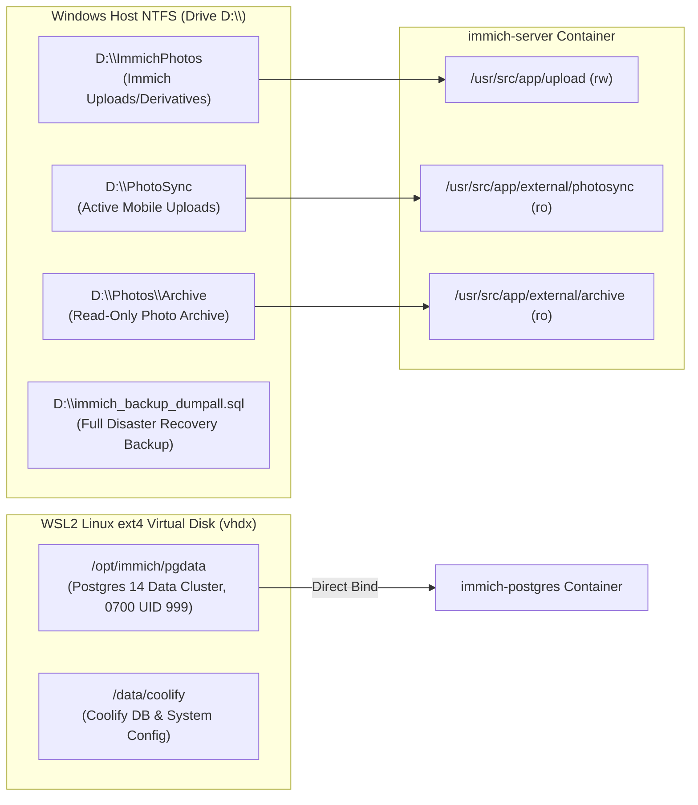
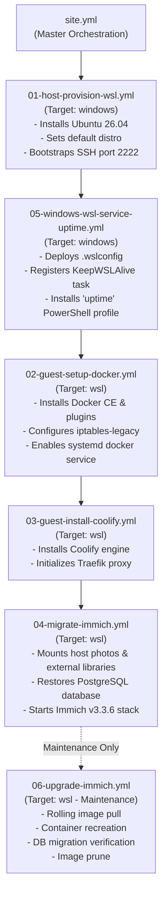
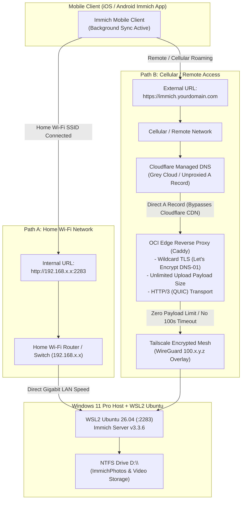

# WSL Docker Server Architecture

This document describes the design, system topology, networking model, storage architecture, and remote access configuration for the `wsl-docker-server` infrastructure.

---

## 1. System Topology Overview

The infrastructure employs a **two-tier virtualization architecture** that runs containerized microservices (Coolify, Immich) inside a persistent **WSL2 Ubuntu 26.04 LTS (Resolute Raccoon)** environment hosted on a **Windows 11 Pro** physical server.

```mermaid
flowchart TD
    subgraph ControlNode ["Control Node / Developer Workstation"]
        Ansible["Ansible CLI (Core 2.21+)"]
        SSHClient["OpenSSH Client (~/.ssh/config)"]
    end

    subgraph Host ["Windows 11 Pro Host (windows-host)"]
        WinSSH["Microsoft OpenSSH (Port 22, sshd.exe)"]
        TaskSched["Windows Task Scheduler\n(KeepWSLAlive - S4U Token)"]
        WSLConfig["%USERPROFILE%\\.wslconfig\n(networkingMode=mirrored, idleTimeout=-1)"]
        PSProfile["PowerShell Profiles\n(Custom 'uptime' Telemetry)"]
        
        subgraph StorageHost ["NTFS High-Capacity Host Storage (D:\\)"]
            UploadDir["D:\\ImmichPhotos (Upload/Library Volume)"]
            PhotoSyncDir["D:\\PhotoSync (Active Mobile Sync)"]
            ArchiveDir["D:\\Photos\\Archive (External Read-Only Library)"]
            SQLBackups["D:\\immich_backup_dumpall.sql (Disaster Recovery Dump)"]
            RawPGData["D:\\immich_pgdata_raw (Raw Postgres 14 Cluster)"]
        end
    end

    subgraph VM ["WSL2 Lightweight Hyper-V VM (Ubuntu 26.04.1 LTS)"]
        WSLSSH["OpenSSH Server (Port 2222, sshd)"]
        Systemd["systemd (init, /etc/wsl.conf)"]
        IPTables["iptables-legacy (Docker Bridge Networking)"]
        DockerEngine["Docker CE 28+ Engine & Compose Plugin"]
        
        subgraph Workloads ["Docker Container Stacks"]
            subgraph CoolifyStack ["Coolify Engine & Proxy"]
                CoolifyApp["coolify:4.6.0 (Dashboard: :8000)"]
                CoolifyDB["coolify-db (PostgreSQL 15)"]
                CoolifyRedis["coolify-redis (Redis 7)"]
                TraefikProxy["coolify-proxy (Traefik: :80 / :443)"]
            end

            subgraph ImmichStack ["Immich Photolab Suite (v3.3.6)"]
                ImmichServer["immich-server:release (:2283)"]
                ImmichML["immich-machine-learning:release (:3003)"]
                ImmichPostgres["immich-postgres (PG 14 + Vector Extensions)"]
                ImmichRedis["immich-redis (Redis 6.2)"]
            end
        end
        
        subgraph Ext4Storage ["Fast Linux ext4 NVMe Storage"]
            OptImmich["/opt/immich/pgdata (ACID POSIX 0700 Permissions)"]
            OptDataCoolify["/data/coolify (Coolify State & DB)"]
        end
    end

    Ansible -->|"SSH (Port 22, PowerShell)"| WinSSH
    Ansible -->|"SSH (Port 2222, Linux apt/docker)"| WSLSSH
    SSHClient -->|"ssh windows-host"| WinSSH
    SSHClient -->|"ssh wsl-server"| WSLSSH

    TaskSched -->|"wsl.exe -d Ubuntu-26.04 -u root sleep infinity"| Systemd
    DockerEngine --> Workloads

    ImmichServer -->|"/usr/src/app/upload"| UploadDir
    ImmichServer -->|"/usr/src/app/external/photosync (ro)"| PhotoSyncDir
    ImmichServer -->|"/usr/src/app/external/archive (ro)"| ArchiveDir
    ImmichPostgres -->|"/var/lib/postgresql/data"| OptImmich
```

---

## 2. Networking Architecture (Mirrored Mode)

WSL2 is configured with `networkingMode=mirrored` in [`wsl-config/.wslconfig`](../wsl-config/.wslconfig). This shares the network namespace between the Windows host and Linux VM:

### Port Allocation Map

| Port | Service | Listening Host / Container | Protocol / Description |
| :--- | :--- | :--- | :--- |
| **`22`** | Windows OpenSSH Server | Windows Host (`sshd.exe`) | Administrative host PowerShell access |
| **`2222`** | Ubuntu OpenSSH Server | WSL2 Guest (`Ubuntu-26.04`) | Direct Linux administrative access & Ansible target |
| **`80`** | Traefik Reverse Proxy | Container (`coolify-proxy`) | HTTP ingress routing |
| **`443`** | Traefik Reverse Proxy | Container (`coolify-proxy`) | HTTPS SSL ingress routing |
| **`2283`** | Immich Photolab Server | Container (`immich-server:release`) | Immich Web UI & mobile API endpoint (v3.3.6) |
| **`3003`** | Immich Machine Learning | Container (`immich-machine-learning`) | Internal facial recognition & CLIP smart search |
| **`5432`** | PostgreSQL Database | Container (`immich-postgres` / `coolify-db`) | Internal relational database |
| **`6379`** | Redis In-Memory Cache | Container (`immich-redis` / `coolify-redis`) | Internal job queues & caching |
| **`8000`** | Coolify Dashboard | Container (`coollabsio/coolify:4.6.0`) | Coolify management UI |

---

## 3. Storage & Volume Strategy

### Why Dual Storage?
1. **Linux ext4 (`/opt/immich/pgdata`)**: PostgreSQL requires strict POSIX permissions (`0700` owned by UID `999`). NTFS filesystems in Windows lack native Linux permissions, causing PostgreSQL to fail if bound directly to NTFS. Storing `pgdata` on ext4 provides maximum database I/O performance and stability.
2. **Windows NTFS (`D:\`)**: High-capacity disk (7+ TB) housing the raw photo library (`D:\PhotoSync`, `D:\Photos\Archive`, `D:\ImmichPhotos`) and automated SQL dump backups (`D:\immich_backup_dumpall.sql`).

---

## 4. Ansible Infrastructure as Code Pipeline

The entire system lifecycle is automated through modular Ansible playbooks orchestrated by [`ansible/site.yml`](../ansible/site.yml):

---

## 5. External Photo Library Configuration in Immich

Because photos can be synchronized to the host via synchronization tools (e.g., PhotoSync), Immich mounts them as read-only **External Libraries**:

1. Log into Immich at your local LAN address (e.g., **`http://192.168.1.100:2283`**) or private Tailscale address (e.g., **`http://100.x.y.z:2283`**).
2. Navigate to **Administration** → **External Libraries** → **Create Library**.
3. Set the import path to:
   - For Mobile Camera Roll / Sync: `/usr/src/app/external/photosync/<Device_Name>/Recents`
   - For Archive Library: `/usr/src/app/external/archive`
4. Click **Scan All Libraries**. Immich will index and generate thumbnails for all photos and videos without altering your original files.

---

## 6. Remote Ingress & Mobile Client Architecture (Dual-URL Routing)

To provide reliable photo and high-definition video backups from mobile devices (iOS / Android) both at home and on the go, the system implements a **Dual-URL Routing Architecture** coupled with **Direct (Unproxied) Edge Ingress**.

### A. The Cloudflare Free Tier Limitation & Why Direct Ingress is Mandatory

Cloudflare CDN proxying (Orange Cloud / Proxied CNAME or A Record) is outstanding for web applications, but introduces two critical limitations that break modern mobile photo backups:

1. **Strict 100 MB Request Body Limit (`HTTP 413 Payload Too Large`)**:
   - Cloudflare Free and Pro plans strictly limit incoming HTTP request bodies to 100 MB.
   - Modern smartphone cameras capture 4K 60fps HDR and ProRes videos that routinely exceed 200 MB to multiple gigabytes per clip (e.g., standard 1-minute 4K clips are ~300 MB).
   - Any video asset exceeding 100 MB fails with an immediate HTTP 413 error or connection termination in the Immich client.
2. **Aggressive 100-Second HTTP Proxy Timeout**:
   - Uploading large video files over mobile cellular connections frequently requires longer than 100 seconds, resulting in `HTTP 524 A timeout occurred` from Cloudflare edge servers.

### B. The Direct (Grey Cloud) Edge Ingress Solution

To eliminate these upload barriers while retaining full end-to-end TLS security:

- **Unproxied DNS Record (`proxied: false`)**: The public DNS record (`immich.yourdomain.com` / `photos.yourdomain.com`) is configured as an unproxied A record (Grey Cloud) pointing directly to the edge reverse proxy VM (Oracle Cloud Infrastructure).
- **Automated Edge TLS Termination**: Caddy on the edge VM terminates TLS using automated Let's Encrypt certificates issued via Cloudflare DNS-01 ACME challenge (which requires no open HTTP validation ports).
- **Streaming Reverse Proxy over Mesh**: Caddy streams uploads of **unlimited payload sizes** directly across the encrypted **Tailscale WireGuard overlay tunnel** into the WSL2 Immich container.
- **HTTP/3 & QUIC Transport**: Modern clients benefit from HTTP/3 packet multiplexing and connection migration over cellular networks without CDN buffering.

### C. Recommended Mobile Client Setup (Dual-URL Routing)

In the Immich mobile application (iOS / Android) under **Settings → Server**:

| Setting Field | Configuration Value | Description |
| :--- | :--- | :--- |
| **Server URL (External)** | `https://immich.yourdomain.com` | Primary URL for remote and cellular sync via OCI Caddy reverse proxy. |
| **Internal Server URL** | `http://192.168.x.x:2283` | Direct LAN Wi-Fi address. The app automatically detects when your device connects to the home Wi-Fi SSID and switches to this endpoint. |

**Benefits of Dual-URL Routing:**
- **Lightning-Fast LAN Backups**: When connected to home Wi-Fi, backups bypass the internet entirely and transfer at local wire/wireless speeds (Gigabit / Wi-Fi 6/7).
- **Zero Data Cap Impact**: Multi-gigabyte video dumps do not consume monthly home ISP upload bandwidth or cellular data when performed on Wi-Fi.
- **Seamless Roaming**: When moving to cellular data, backups continue automatically via the direct edge reverse proxy URL without upload size limits or timeouts.
